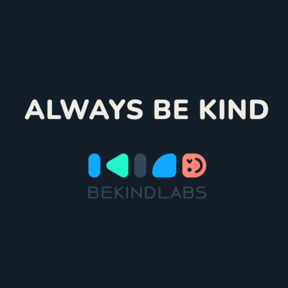
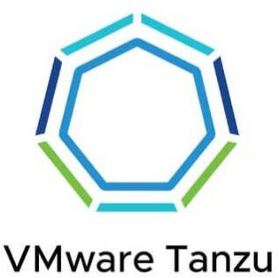
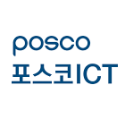
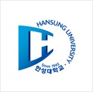

 

생각과 경험을 정리하여 누군가에게 도움이 되는 지식으로 만드는 일을 즐깁니다.

8년 차 시니어 풀스택 엔지니어이자 XP 코치로, Toyota, Honda, KB국민은행, LG U+, POSCO 등의 시스템을 만들고 현대화해 왔습니다. 제철소 물류와 실시간 공장 모니터링부터 프런트오피스 트레이딩, 마이데이터 기반 추천까지 복잡한 비즈니스 영역의 도메인 모델을 설계합니다. 새로 시작하는 MVP(그린필드)와 기존 시스템 현대화(브라운필드)를 모두 즐기며, 팀에 TDD, 페어 프로그래밍, 지속적 배포를 코칭합니다.

## 현재

- 비카인드랩스 시니어 소프트웨어 엔지니어

## 주요 성과

- **Toyota** (2023 – 2026)
  - 교육, 스포츠, 헬스케어, 행사 등 다양한 도메인의 웹·iOS 신규 서비스 6건을 MVP부터 출시까지 수행
  - ACoE 팀에서 여러 제품 팀의 애자일 프랙티스 정착을 지원하고, Spring Security 내부 분석으로 OAuth2 인증 장애(스레드 락, WAF 호스트 재작성 등)의 근본 원인 해결
  - 이미지·영상 처리의 메모리 누수, OOM, 디스크 부족 문제를 해결하고, 썸네일 구조 리팩토링과 CloudFront CDN 구축으로 기술 부채 해소
- **Honda** (2024)
  - 공장 PLC 센서 데이터를 MQTT로 실시간 수집하는 용접 공정 모니터링 시스템 구축, 공정 속도와 버퍼 잔량 기반으로 목표 달성 시각 및 라인 정지 위험 시뮬레이션
- **LG U+** (2023)
  - 차세대 시스템 전환 중 기존 클라이언트를 위한 API 하위 호환 어댑터 서비스 구축
- **KB국민은행** (2022 – 2023)
  - 데스크톱 트레이딩 앱을 웹 서비스로 재구축하고, 부패 방지 계층(ACL)으로 레거시 의존성 격리
  - 마이데이터 기반 요금제 추천 MVP 개발, 레거시 EAI 메시징 모듈 리팩토링으로 코드 70% 축소
- **POSCO** (2018 – 2021)
  - 모놀리식 야드 관리 시스템을 마이크로서비스로 재설계, 품종별 일 3,000만 건 이상의 API 트래픽 처리
  - 인메모리 캐시와 Kafka 기반 동기화로 공용 룰 엔진 응답 시간을 5초 이상에서 1초 미만으로 단축

## 기술 스택

Java, Kotlin, Spring Boot, Spring Security, TypeScript, React, Kafka, Redis, AWS, Terraform, MCP servers

## 집필

- [안쪽까지 들여다보는 스프링 시큐리티](https://www.yes24.com/product/goods/180391041) (비제이퍼블릭, 2026)

## 경력

 
  
  <h3 id="bekindlabs" class="reusme__company">
    Bekind Labs
    Senior Software Engineer
    2025년 01월 - PRESENT
  </h3>

##### [Toyota] 사내 직원 간 피드백·소통 플랫폼, 2026년 5월 - 7월

- 토요타 사내 매니저와 구성원이 소통하고 상호 피드백을 주고받는 플랫폼의 기술 부채 해소 및 운영 안정화
- 조회 시점마다 썸네일을 생성하던 구조를 업로드 시점 생성으로 리팩토링하여 API 서버 메모리 사용량 안정화
- 기존 이미지 썸네일 마이그레이션을 이미지 별 비동기 태스크로 분리해 대용량 PNG 처리 시 발생하는 OOM 문제 해결
- 서명된 쿠키(signed cookie)와 OAC를 적용한 CloudFront CDN 구축으로 API 서버를 경유하는 이미지 트래픽 제거
- 수동으로 관리하던 인프라를 Terraform으로 import
- 장애 대응 플레이북, SLI/SLO 정의 및 New Relic 모니터링 대시보드 구축 참여

##### [Toyota] 운동선수 재활 운동 치료 서비스, 2026년 1월 - 5월

- 운동선수의 재활 운동 치료를 지원하는 신규 서비스 개발
- ffmpeg 시크(seek) 옵션과 pre-signed URL로 필요한 프레임만 디코딩하도록 AWS 람다 동영상 썸네일 생성 로직 개선, 1GB 4K 영상 처리 시 발생하던 디스크 부족 에러 해소 및 메모리 사용량 절감
- 서명된 쿠키(signed cookie)와 OAC를 적용한 CloudFront CDN 구축으로 pre-signed URL 환경에서 동작하지 않던 브라우저 캐시 문제 해결
- Terraform 기반 서버리스 인프라 구성 관리

##### [Toyota DIG] ACoE (Agile Center of Excellence) 팀, 2025년 1월 - 12월

- 여러 제품 팀의 애자일 프랙티스 강화, 기술 부채 분석·해소 및 테스트 커버리지 향상 지원
- MS AAD 인증 시 JWKs 조회 스레드 락으로 신규 로그인이 전면 실패하던 장애의 근본 원인 규명 및 RestTemplate 타임아웃·로깅 적용한 프록시 패턴으로 재발 방지
- 외부 WAF의 호스트 재작성으로 OAuth2 리다이렉트가 내부 도메인으로 향하던 문제를 프록시 패턴 기반 AuthorizationRequestResolver 확장을 통해 해결
- 세션 만료 후 재로그인 시 웹소켓 핸드셰이크 경로로 리다이렉트되던 문제를 Spring Security RequestCache 동작 분석으로 해결
- ALB-애플리케이션 구간 프로토콜 변환으로 인한 OAuth2 redirect_uri 불일치 문제를 Forwarded 헤더 처리 설정으로 해결
- 1.5GB 이상 파일 변환 시 서버 자원 고갈과 504 타임아웃 문제에 대해 S3 pre-signed URL, EventBridge, ECS 태스크 기반 이벤트 드리븐 아키텍처 설계 제안

 
  
  <h3 id="vmware" class="reusme__company">
    VMware
    Tanzu Labs Software Engineer
    2021년 11월 - 2025년 1월
  </h3>

##### [Toyota] 토요타 특성화 고등학교 학생 평가 시스템, 2024년 7월 - 12월

- 토요타가 운영하는 고등학교의 학생 평가 및 피드백 관리 시스템
- 평가 및 피드백 프로세스를 위한 도메인 설계 및 구현
- 메인 스토리지로 AWS DynamoDB 사용, 기능 추가 시 접근 패턴 분석·GSI 설계·데이터 마이그레이션 프로세스를 수립해 잦은 요구사항 변경에 대응
- 프로젝트 초기 E2E 테스트 구축 및 단위 테스트와 중복되는 검증을 핵심 사용자 시나리오 중심으로 리팩토링
- 테라폼(Terraform)으로 DynamoDB 마이그레이션, KMS 암호화 등 잦은 인프라 변경을 코드 기반으로 관리
- 일본어로 고객사 스테이크홀더와 요구사항을 직접 논의하고 고객사 개발자와 페어 프로그래밍 수행

##### [Toyota] 아마추어 러너 달리기 자세 멘토링 서비스, 2024년 4월 - 5월

- 아마추어 러너(runner)들을 위한 프로 선수들의 달리기 자세 멘토링 서비스
- iOS 및 웹 애플리케이션 MS AAD OAuth2 인증 프로세스 통합
- iOS 및 웹 애플리케이션 서비스 자체 인증 프로세스 구축
- JDK21 기반 스프링 애플리케이션 이미지 업로드 시 다이렉트 메모리(direct memory) 누수 현상 분석 및 해결
- 러너 달리기 자세 영상에 대한 비동기 스켈레톤 추출 프로세싱 서비스 구현

##### [Honda] 공장 프로세스 모니터링, 2024년 1월 - 3월

- 혼다 실시간 웰딩(welding) 공정 작업 현황 모니터링 웹 애플리케이션
- 웰딩 공정 내 유닛(unit) 별 작업 현황 모니터링을 위한 도메인 설계 및 구현
- 모스키토(mosquitto) MQTT 브로커를 통한 공장 PLC 센서의 데이터를 실시간으로 수집
- 조업자들의 작업 스케줄을 조정할 때 도움을 주는 실시간 작업 현황을 시각화
- 실시간 작업 완료 차량 대수와 공정 진행 속도를 기반으로 목표 대수 달성 예상 완료 시간 시뮬레이션
- 후속 웰딩 유닛 이전에 위치한 버퍼의 잔여 수와 공정 진행 속도를 기반으로 공장 가동에 문제가 발생할 수 있는 시각 시뮬레이션
- GitHub Actions CI/CD 파이프라인 구축

##### [Toyota] 어린이 컨퍼런스 네비게이션 웹 애플리케이션, 2023년 9월 - 11월

- 어린이 대상 컨퍼런스 참여자들에게 프로그램 정보, 예약 정보, 직소(jigsaw) 퍼즐 게임을 제공하는 웹 애플리케이션
- 행사 스케줄, 고객 예약 정보 관리 및 퍼즐 수집 게임 도메인 설계 및 구현
- 동일한 퍼즐 조각이 여러번 수집되는 동시성 문제 해결 및 예외 처리
- 퍼즐 게임 디자인 구현 및 애니메이션 처리
- Google Analytics, Google Tag Manager 연결을 통한 사용자 데이터 수집

##### [Toyota] 사내 컨퍼런스 네비게이션 애플리케이션, 2023년 7월 - 8월

- 토요타 사내 컨퍼런스 참여자들에게 참여 부스 정보를 제공하는 웹 애플리케이션
- AAD(Azure Active Directory) OAuth2 인증과 서비스 자체 로그인 기능 통합
- 사용자 정보를 세션에 저장 시 영속성 컨텍스트가 연결된 상태로 객체가 직렬화 되어 발생하는 버그 수정
- Google Analytics, Google Tag Manager 연결을 통한 사용자 데이터 수집 기능 개발

##### [LG U+] 차세대 시스템 API 하위 호환 어댑터 서비스, 2023년 6월 - 7월

- 차세대 시스템과 클라이언트 사이의 API 하위 호환성 문제를 해결하기 위한 어댑터 서비스
- 레디스와 웹 필터를 사용한 클라이언트 인증 프로세스 구현
- 외부 서비스 API 호출 기능 구현 및 와이어 목을 활용한 결합 테스트 검증

##### [Toyota] EXPO 사내 컨퍼런스 네비게이션 애플리케이션, 2023년 3월 - 4월

- 토요타 사내 컨퍼런스 참여자들에게 프로그램 정보를 제공하는 웹 애플리케이션
- 단위 테스트와 리팩토링을 통한 컴포넌트 재구성과 점진적인 신규 기능 확장
- 카드 수집 시 등장 애니메이션 버그 수정
- Google Analytics, Google Tag Manager 연결을 통한 사용자 데이터 수집 기능 개발

##### [KB 국민은행] 프론트 오피스 업무 전용 거래 서비스, 2022년 10월 - 2023년 2월

- 프론트 오피스 업무 거래용 윈도우 GUI 애플리케이션을 웹 기반 서비스로 재구축
- 트레이더 정보 및 권한 관리, 코드 관리, 선물(future) 상품 및 거래 도메인 모델 설계 및 개발
- 외국 거래 입력 시 시차로 인해 발생하는 이슈 해결을 위한 타임존 도메인 설계 및 개발
- SSO 인증 프로세스 개발 및 사용자 권한 서비스 연계
- 레거시 연계로 인해 발생하는 도메인 오염 방지를 위한 ACL(anti corruption layer) 구축
- Jenkins CI/CD 파이프라인 구축

##### [KB 국민은행] 마이데이터 기반 맞춤형 LiivM 요금제 추천 서비스, 2022년 1월 - 6월

- 마이데이터를 활용한 사용자 맞춤 알뜰폰 요금제 추천 MVP 서비스 개발
- 마이데이터 기반 알뜰폰 추천을 위한 신규 상품 추천 도메인 모델 설계 및 개발
- KB 사내 마이데이터 플랫폼 서비스 최초 연계 및 사용
- KB 레거시 EAI 메시징 서비스 분석 및 리팩토링을 통한 코드 70% 축소
- Jenkins CI/CD 파이프라인 구축

 
  
  <h3 id="geneuin" class="reusme__company">
    Geneuin
    Lead Developer
    2021년 4월 - 11월
  </h3>

##### [한국보건산업진흥원] IoT 돌봄 서비스 고도화 프로젝트, 2021년 8월 - 11월

- 노인 거주지 및 장애인 시설 내 IoT 센서를 사용한 돌봄 서비스 고도화 프로젝트
- 업무 게시판, 돌봄 대상자 관리, 시설 도면 업로드 및 IoT 센서 맵핑 기능 개발
- 신규 모바일 서비스 개발 및 사용자 PIN 번호 발급을 통한 2차 인증 프로세스 구현
- 사용자 로그아웃 시 브라우저 쿠키 초기화 실패로 인한 재접속 불가능 버그 수정
- 레거시의 불필요 컴포넌트들 제거 및 코드 리팩토링을 통한 50% 코드 축소

##### [KC Industrial] 반도체 가스 공정 MES 개발 프로젝트, 2021년 5월 - 8월

- 가스 공정 자동화ㆍ모니터링 웹 서비스 구현
- 가스 용기 특성과 물류 흐름에 맞는 도메인 모델 설계 및 개발
- 가스 용기 입고, 전처리, 충전, 품질 검사, 출고, 반품 및 회수 처리 자동화 및 리포팅 기능 구현
- 실린더 번들 부적합 발생 시 이벤트 발행ㆍ구독 패턴을 통한 결합도 낮은 비즈니스 로직 구현
- 수백 개 입고되는 가스 용기들의 납품 PDF 문서를 CSV 파일로 변경하는 수작업을 자동화
- 용기 번호와 LOT 번호에 맞는 바코드 생성 및 출력 작업 자동화

 
  
  <h3 id="posco-ict" class="reusme__company">
    POSCO ICT
    MES Application Developer
    2018년 7월 – 2021년 4월
  </h3>

##### [POSCO ICT] POSCO MES3.0 야드 관리 시스템 운영, 2020년 6월 - 2021년 4월

- 포항, 광양 제철소의 야드 관리 시스템 운영 (슬라브, 코일, 후판 및 선재 품종 별 서비스)
- 각 품종 별로 하루 평균 3000만 건을 초과하는 API 트래픽 처리 
- 소재, 제품 이적 시 충돌, 추락 등으로 발생하는 품질 저하를 유발하는 장애 추적 및 개선
- 소재, 제품 적치 시 발생할 수 있는 인명 사고를 방지하기 위한 장애 추적 및 개선
- DB 트랜잭션 경합 시 비관적 락 방식의 데이터 선점과 예외 처리를 통한 데드락 현상 해소
- 이송 효율 증가와 크레인 작업자 피로도 감소를 위한 포항 전강 창고 차량 이송 물류 자동화
- 24시간 야드 관리 시스템 모니터링 및 장애 대응
- 기타 SR(service request) 처리

##### [POSCO ICT] POSCO MES3.0 야드 관리 시스템 개발, 2018년 7월 – 2020년 5월

- 모노리스 POSCO MES 야드 관리 시스템을 마이크로서비스 아키텍처로 재구축
- 타 공정, 조업, 운송, 출하 시스템 API 연결 및 폴백(fallback) 처리 구현
- 야드 관리 시스템 공통 비즈니스 룰 엔진 컴포넌트 리팩토링
- 야드 관리 시스템 소재, 제품 적치를 위한 스케줄링 도메인 객체 리팩토링 및 개발
- 메모리 캐시와 Kafka를 사용한 데이터 동기화로 룰 엔진 컴포넌트 80% 속도 개선
  - 5초 이상 소요 시간을 1초 미만으로 개선
- 이송 물류 개선을 위한 차량 이송 물류 스케줄링 구현
  - 이송될 물류를 미리 그룹화하고 순번을 지정하는 스케줄링 이후 타 운송 시스템으로 목록과 순번을 전송

 
  
  <h3 id="posco-ict-intern" class="reusme__company">
    POSCO ICT
    Internship
    2017년 8월 - 2017년 11월
  </h3>

##### [POSCO ICT] Smart CCTV 시스템 애플리케이션 개발, 2017년 8월 - 11월

- 영상 인식을 통한 다트(dart) 공정 이상(abnormal) 감지 애플리케이션 개발
- SVM(Support Vector Machine) 머신 러닝 알고리즘 활용

## Education

 
  
  <h3 class="reusme__company">
    Hansung University
    학사
    2014년 2월 - 2018년 2월
  </h3>

##### 정보통신공학과 전공

- 학점 4.45 / 4.5
- 우촌상 수상
  - 후기졸업자로서 전기졸업포상자를 포함해 전교에서 학업성적이 최우수한 자
- 아산 성적 우수 장학생 3년 선정
  - 2015년 - 2017년
- 제34회 전국 대학생 수학 경시대회(비수학전공분야) 은상 수상
  - 대한수학회, 고등과학원 주최
- 2016 미래전파 창의 아이디어 설계 제작 공모전 우수상 수상
  - 국립전파연구원 주최